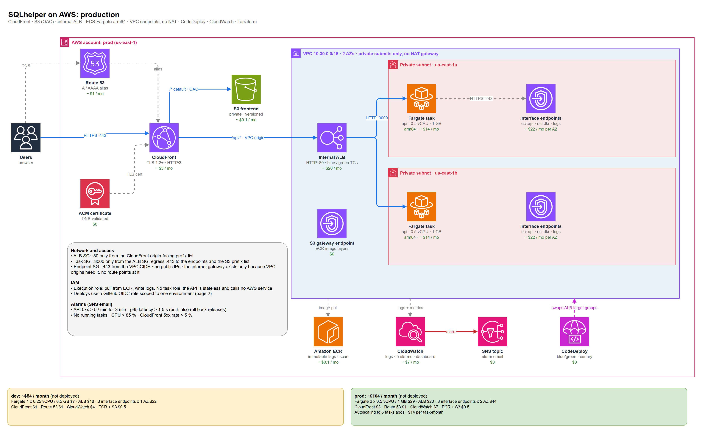
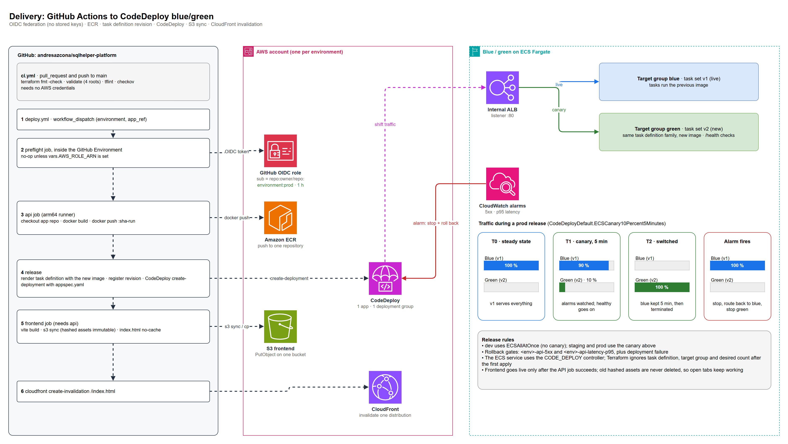
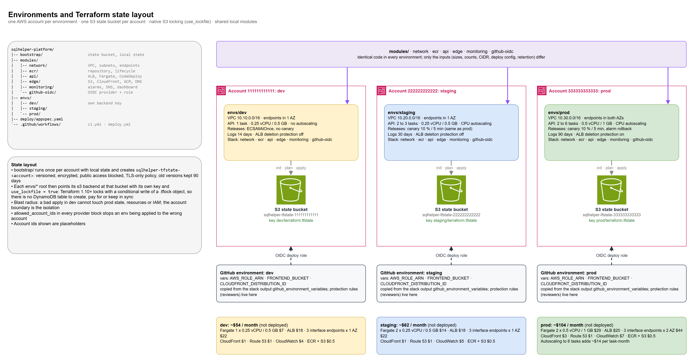

# sqlhelper-platform

Production-grade AWS platform, in Terraform, for [SQLhelper](https://github.com/andresazcona/SQLhelper): a stateless web app that turns SQL DDL from several dialects into Mermaid ER diagrams. Nothing here is deployed; it is written to be applied, and every commit is validated.


[](https://github.com/andresazcona/sqlhelper-platform/actions/workflows/ci.yml)



## Problem and goals

SQLhelper is two TypeScript apps (`SQLhelper-front`: React + Vite SPA; `SQLhelper-back`: Express on port 3000 with `/health` and `/api/{detect,parse}`). Reading its code and Dockerfiles gave the shape of the platform:

- **No database.** The API parses text and returns JSON, so there is no RDS, no cache, no persistent volume. The only state is Terraform's own.
- The SPA is static (Vite build), so it belongs on S3 + CloudFront rather than in a container; the API is the only compute.
- The SPA reads `VITE_API_URL`, so serving both from one CloudFront origin (`/api/*` to the API) removes CORS from the request path.

Goals: private-by-default network, zero-downtime releases with automatic rollback, no long-lived credentials anywhere, three isolated environments from one code base, and a bill that fits a stateless app.

## Architecture

1. **Edge.** Route 53 aliases the domain to CloudFront (ACM certificate, TLS 1.2+, HTTP/3). The default behaviour serves the SPA from a private S3 bucket through Origin Access Control, with a viewer-request function rewriting SPA routes to `index.html`. `/api/*` goes to the API with caching disabled.
2. **Network.** One VPC, two AZs, **private subnets only**. CloudFront reaches the **internal** ALB through a CloudFront VPC origin, so there is no public load balancer and no public IP in the VPC. The ALB security group only admits the CloudFront origin-facing managed prefix list.
3. **Compute.** ECS Fargate on Graviton (arm64), `awsvpc`, read-only root filesystem, one task per AZ in prod. Tasks pull from ECR and write logs through VPC endpoints.
4. **Releases.** The ECS service uses the `CODE_DEPLOY` controller with two target groups (blue/green). CodeDeploy shifts the ALB listener, watches two CloudWatch alarms and rolls back on failure or alarm.
5. **Observability.** Log group with per-env retention, five alarms (5xx, p95 latency, running tasks, CPU, CloudFront 5xx) to SNS, and one dashboard.
6. **CI/CD.** GitHub Actions authenticates through OIDC into a role limited to one environment and one set of resources.





The editable source is `docs/diagrams/sqlhelper-platform.drawio` (3 pages), generated by `docs/diagrams/gen_drawio.py`.

## Key decisions

- **VPC endpoints instead of NAT gateways.** Tasks only talk to ECR, S3 and CloudWatch Logs, so ECR (api + dkr) and Logs interface endpoints plus a free S3 gateway endpoint replace the NAT. Prod: 3 endpoints x 2 AZ = about $44 / month vs about $66 for two NAT gateways (before the per-GB charge), and there is no path to the internet at all. Trade-off: a new AWS dependency (say, Secrets Manager) needs another endpoint; the app has none today. Dev and staging pin the endpoints to one AZ to save about $22 each, accepting cross-AZ calls.
- **Internal ALB behind a CloudFront VPC origin.** Removes the public ALB attack surface and keeps TLS at the only public hop. The ALB listener is plain HTTP on purpose: that hop never leaves AWS. An internet gateway is attached because VPC origins require it; no route table points to it.
- **Same-origin `/api`.** Avoids CORS preflights and a second certificate and DNS name. `CORS_ORIGIN` is still set so the API is correct if it is ever called cross-origin.
- **CodeDeploy blue/green over ECS rolling updates.** Instant, traffic-level rollback and canary (10 % for 5 minutes in staging/prod; all-at-once in dev). The old task set stays 5 minutes after the switch. Cost: two target groups and an AppSpec. Terraform ignores task definition, target group and desired count after the first apply because CodeDeploy and autoscaling own them.
- **CPU target-tracking autoscaling (60 %), not `ALBRequestCountPerTarget`.** That metric is bound to one target group, and blue/green swaps target groups on every release.
- **Remote state: S3 native locking (`use_lockfile`), no DynamoDB.** Terraform 1.10+ locks with a conditional write of a `.tflock` object. One resource fewer to create, pay for and keep consistent. The bucket is versioned, encrypted, TLS-only, with `prevent_destroy`. Trade-off: needs Terraform >= 1.10 for everyone.
- **One AWS account per environment.** The account boundary is the blast radius; each provider block has `allowed_account_ids`. Account ids in the repo are placeholders (`111111111111`...).
- **GitHub OIDC, least privilege.** The trust policy pins `sub` to `repo:<owner>/<repo>:environment:<env>`. The role can: log in to ECR and push to one repository, register task definitions, describe one service, `iam:PassRole` only the execution role, create deployments in one CodeDeploy group, put objects in one bucket and invalidate one distribution. It cannot delete S3 objects: hashed assets are immutable and never removed, so open tabs keep loading their chunks.
- **ARM64 everywhere.** About 20 % cheaper Fargate; the deploy job builds natively on an arm64 runner (no QEMU, no Docker emulation).
- **Immutable ECR tags** (`<sha>-<run>`), scan on push, keep last 30 images.
- **Skipped scanner findings are explicit** in `.checkov.yaml` with a reason each (internal HTTP hop, no CMK for a data-less app, access/flow logs, WAF on the next list).

## Repository layout

```
bootstrap/            state bucket (local state, once per account)
modules/
  network/            VPC, private subnets, S3 + interface endpoints
  ecr/                repository + lifecycle policy
  api/                internal ALB, ECS Fargate, CodeDeploy, autoscaling
  edge/               S3 + CloudFront (OAC, VPC origin), ACM, Route 53
  monitoring/         alarms, SNS, dashboard
  github-oidc/        OIDC provider + least-privilege deploy role
envs/{dev,staging,prod}/   compose the modules; own backend key and tfvars
deploy/appspec.yaml   CodeDeploy AppSpec
.github/workflows/    ci.yml (static checks), deploy.yml (guarded release)
docs/diagrams/        draw.io source, generator and PNGs
```

| | dev | staging | prod |
|---|---|---|---|
| Account (placeholder) | 111111111111 | 222222222222 | 333333333333 |
| VPC CIDR | 10.10.0.0/16 | 10.20.0.0/16 | 10.30.0.0/16 |
| Interface endpoints | 1 AZ | 1 AZ | both AZs |
| Tasks | 1 x 0.25 vCPU / 0.5 GB | 2-3 x 0.25 / 0.5 | 2-6 x 0.5 vCPU / 1 GB |
| Release strategy | all at once | canary 10 % / 5 min | canary 10 % / 5 min |
| Log retention | 14 d | 30 d | 90 d |
| ALB deletion protection | off | off | on |

## Validate locally

No AWS credentials are needed.

```sh
terraform fmt -check -recursive
for d in bootstrap envs/dev envs/staging envs/prod; do
  terraform -chdir=$d init -backend=false -input=false && terraform -chdir=$d validate
done
tflint --init && tflint --recursive --config "$PWD/.tflint.hcl"
checkov -d . --config-file .checkov.yaml
python docs/diagrams/gen_drawio.py      # regenerates the .drawio
```

`ci.yml` runs the same checks on every PR. `deploy.yml` is a manual `workflow_dispatch` (environment + app ref) and its first job does nothing unless the GitHub environment defines `AWS_ROLE_ARN`, so forks and fresh clones never try to reach AWS.

To adopt it for real: run `bootstrap/` in each account, point the backend block in `envs/<env>/terraform.tf` at that bucket, set the `tfvars` (domain, hosted zone must exist, alarm email), apply, then copy `terraform output github_environment_variables` into the matching GitHub environment.

## Cost estimate (not deployed)

us-east-1 on-demand list prices, 730 h/month, Fargate ARM at $0.03238 / vCPU-h and $0.00356 / GB-h, interface endpoints $0.01 / AZ-h, ALB $0.0225 / h plus a few dollars of LCU at low traffic, CloudFront and CloudWatch inside or near free tiers (Container Insights is the main CloudWatch line). Traffic is assumed low (a few hundred MB, tens of thousands of requests). Rounded to the dollar.

| Item | dev | staging | prod |
|---|---:|---:|---:|
| Fargate tasks | $7 | $14 | $29 |
| ALB | $18 | $18 | $20 |
| Interface endpoints (3) | $22 (1 AZ) | $22 (1 AZ) | $44 (2 AZ) |
| CloudFront | $1 | $1 | $3 |
| Route 53 (zone + queries) | $1 | $1 | $1 |
| CloudWatch (Insights, logs, alarms) | $4 | $5 | $7 |
| ECR + S3 + SNS + state | $0.5 | $0.5 | $0.5 |
| **Total / month** | **~$54** | **~$62** | **~$104** |

Prod autoscaling to the 6-task ceiling adds about $14 per extra task-month. The largest fixed costs are the ALB and the endpoints; the NAT alternative would cost more in every environment.

## What I would add next

- AWS WAF with a rate-based rule on the CloudFront distribution (the API is public and unauthenticated).
- ALB, CloudFront and VPC flow logs to a log-archive bucket, plus a customer-managed KMS key if the app ever stores user data.
- A scheduled-scaling or Fargate Spot capacity provider for dev and staging.
- Synthetic canary on `/health` and the parse endpoint, wired into the CodeDeploy alarm set.
- A `terraform plan` job on PRs through a read-only OIDC role, and Renovate for provider and action pins.
- Cross-region state replication and a documented DR runbook.

## License

[MIT](LICENSE) © 2026 Andres Azcona
